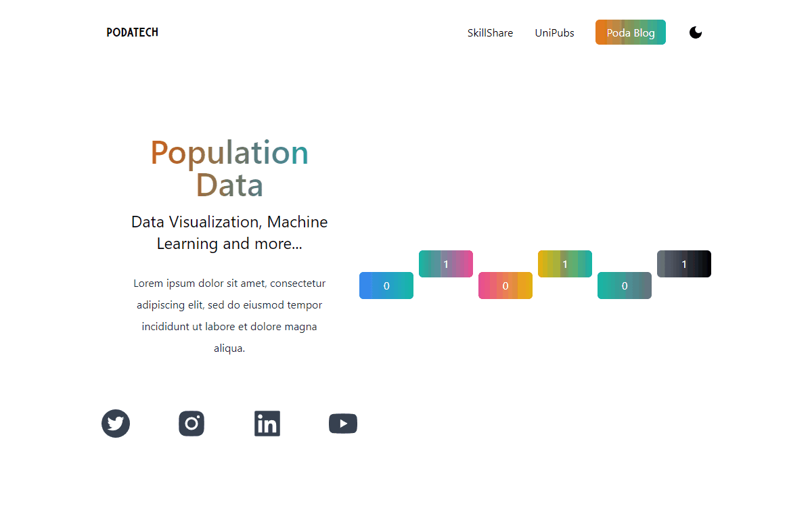

# Poda Tech

A population data landing page with dark mode, built with Next.js and Tailwind CSS.



## About
A marketing/landing page for "Poda Tech", pitched around population data visualization and machine learning. Built October 2022.

## Features
- Landing page with hero section and navigation
- Dark mode toggle
- Social links (Twitter, LinkedIn, YouTube, Instagram)
- Responsive layout

## Tech stack
- Next.js 12, React 18
- Tailwind CSS
- react-icons

## Project structure
```
pages/          # Next.js pages and API routes
styles/         # global and module CSS
public/         # static assets (images, fonts)
```

## Getting started
```
npm install
npm run dev
```
Open http://localhost:3000.

## Status
Learning/demo project, not actively maintained.

## Live
https://dapper-fox-dea6e6.netlify.app/
